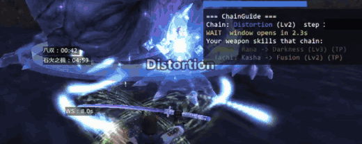
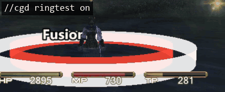

# ChainGuide (v0.2.0)

**A skillchain guide for Windower 4 (FINAL FANTASY XI). It shows information only. It never uses a weapon skill for you.**

ChainGuide watches the weapon skills used on your target and shows, on a small HUD:

- the skillchain that is resonating, its property and level, and a colored bar;
- how long until the chain window opens, and how long it has left;
- which of **your own** weapon skills would continue the chain, and what chain each one would make.

You choose and press the weapon skill yourself. ChainGuide does not send any command to the game (no `input /ws`, no macros, no key presses).

> **v0.2.0: lightly tested.** It passes 37 checks in a simulated Windower environment, and I have used it in game (display, bar, dragging and the mouse wheel worked; the optional rings worked in a number of fights), but on the Japanese client only. I have not tested it on the English client, nor with every job and weapon. The timing numbers are guides, not exact. Please report anything that looks wrong.

## What it shows

```
=== ChainGuide ===
Chain: Fusion (Lv2)  step 1  by Ally5
GO!   6.4s left
Your weapon skills that chain:
> Savage Blade -> Light (Lv3)
```

(Sample output. The weapon skills listed depend on your job and weapon. Ones you cannot use right now are dimmed and marked `(TP)` or `(range)`.)

- **The bar** above the HUD takes the color of the chain's element (Fire red, Ice light blue, Wind green, Earth yellow, Thunder purple, Water blue, Light white, Dark violet). A chain with several elements (for example Fusion = Fire + Light) cycles through its colors.
- **WAIT / GO.** For the first 3 seconds or so after a weapon skill lands, the bar is solid and the HUD says WAIT: a weapon skill used now does not chain. Then the HUD says GO and the bar blinks, faster and faster as the window closes.
- **The list** has only your weapon skills that continue the current chain, best first (a weapon skill you can use right now comes first; then higher chain level). Ones you cannot use right now are dimmed, with the reason: `(TP)` not enough TP, `(range)` too far to reach.
- **All weapon types.** There is no weapon list inside the addon: your usable weapon skills and their chain properties are read from Windower's resources, so it works for every weapon type and job that has chainable weapon skills (weapon skills that do not chain, such as Starlight or Spirits Within, are not listed). I have only tried it in game with a few weapons so far.
- **Aeonic weapons:** if you wield an aeonic weapon, its Light/Darkness property is counted.
- **While there is no chain** it lists your weapon skills and their properties, to help you pick an opener.
- **After a Light -> Light or Darkness -> Darkness chain**, or a Radiance/Umbra chain, it says the chain is complete: nothing chains after that.

## Optional: rings on the ground (v0.2.0)



When a chain lands, rings appear on the ground around the enemy, and the **name of the chain** (Fusion, Liquefaction, Impaction, Detonation ...) is written beside them. There is one ring per element of the chain, in the element's color (Fusion: red and white; Gravitation: yellow and black; Light: four rings). The rings stay dim until the chain window opens, then are bright and fade out step by step until it closes. They are drawn in the 3D world, so terrain and the enemy's body can hide them (they float a little above the ground to help).

**This part is optional and does nothing until you add three extra files** (a small DLL library) that hook the game's graphics. See "Turning the rings on" below, **including the risks**.

You can set the look while you watch it:



- `//cgd ringtest on [chain name]` shows a ring that stays (around your target, or around you) until `//cgd ringtest off`. For example `//cgd ringtest on Gravitation`.
- While it is on, **turn the mouse wheel** (with the cursor off the HUD) to change the ring size. (The ring cannot be picked with a drag: Windower cannot tell where something in the 3D world is on the screen.)
- `//cgd labelangle <degrees>`, `//cgd labelsize <x>` and `//cgd labelheight <n>` move and resize the chain name. The name sits on the side of the ring that faces you, turned by the angle (the default, 15, is a little to the right; negative is to the left), so a big enemy's head does not cover it.

### Turning the rings on

The three files are in the `optional-ring` folder. Windower's Lua does not read that folder, so by default nothing changes.

1. Close the game (one of the DLLs stays loaded until the game closes).
2. Move `worlddraw.dll`, `worlddraw_daemon.dll` and `worlddraw.lua` from `ChainGuide/optional-ring/` into `ChainGuide/libs/` (the `libs/labels` folder with the chain-name pictures is already there).
3. Start the game and load ChainGuide. The rings appear when a chain lands. `//cgd ring off` turns them off; to remove them completely, close the game and move the files back.

If you want to build the files yourself instead of using the ones in the folder, download `ChainGuide-ring-source.zip` from the [Releases](../../releases) page: it has the library's source and the build steps.

**Risks.** The rings use [ffxi_world_draw](https://github.com/genoxd/ffxi_world_draw) by Genoxd (0BSD license; thank you for making it public). Inside the game process, it patches the game's Direct3D device function table (the same kind of hook that Discord's and ReShade's overlays use), so it writes to the game's memory, and it scans the game's `FFXiMain.dll` to find the camera and the entity table, which it reads. It does not change the game's code or data. That is a bigger risk than a normal addon:

- Using Windower is not permitted by the FFXI Terms of Service, and a graphics hook is more intrusive than most addons. I cannot say whether it can be detected.
- Another overlay or addon that hooks the same graphics calls can conflict with it, and a game update can break it until the library is updated. If the game freezes or crashes, remove the files.
- The files are unsigned, so some antivirus software may warn about them.
- The three files in the folder were built from the library's source (commit `622e7c13`) with MinGW-w64; their SHA256 is in `optional-ring/README.txt`. They are not byte-identical to the files in Genoxd's repository, because the compiler differs.

I have tried it on the Japanese client in a limited number of fights.

## Install

1. Put the `ChainGuide` folder in `Windower4/addons/` (the folder must be named `ChainGuide`; if you downloaded a zip of the repository, rename the folder).
2. In game: `//lua l ChainGuide`. To load it automatically, add `lua l ChainGuide` to `Windower4/scripts/init.txt`.
3. `//cgd test` shows a sample chain for 12 seconds so you can check the display. **Drag the HUD with the mouse to move it, and scroll the mouse wheel over it to make it bigger or smaller** (the colored bar scales with it). The position and size are saved.

It needs only Windower's standard libraries (`config`, `texts`, `images`, `resources`, `packets`).

## Commands (`//cgd` or `//chainguide`)

| Command | What it does |
|---|---|
| `//cgd on` / `off` | Show / hide the guide |
| `//cgd combat [on\|off]` | Show it only while you are engaged or a chain is active (default on) |
| `//cgd rows <n>` | How many weapon skills to list (default 6) |
| `//cgd openers [on\|off]` | List your weapon skills while no chain is active (default on) |
| `//cgd bar [on\|off]` | The colored bar |
| `//cgd pos <x> <y>` / `//cgd size <n>` | HUD position / text size (you can also drag the HUD with the mouse, and scroll the mouse wheel over it to scale it) |
| `//cgd ring [on\|off]` | The rings on the ground (needs the optional ring pack) |
| `//cgd ringstatus` | Whether the ring library is loaded, and its last message |
| `//cgd ringtest on [chain]` / `off` | A ring that stays, to set its look (mouse wheel = size) |
| `//cgd ringsize <x>` | Ring size, x (1 = normal) |
| `//cgd labelangle <deg>` / `labelsize <x>` / `labelheight <n>` | Where the chain name sits, its size and its height |
| `//cgd test` | Show a sample chain for 12 seconds |
| `//cgd status` | Current settings |

## How it works, and its limits

- The action packet (0x028) tells it which weapon skill was used on **your current target** and whether it made a skillchain. Weapon skills of anyone count (you, party members, trusts, other players), but only on the enemy you are targeting.
- Skillchain rules (which property chains into which) are from the BG-Wiki "Skillchain" page. Weapon skill properties come from Windower's resources. ChainGuide itself reads and writes no game memory. (The optional ring pack is different: see "Optional: rings on the ground" above.)
- The time until the window opens (about 3 s; the value used is 3.3 s to be safe) and the window length (10 s, shorter after each chain, 4 s at the least) are the values I use in [OmniChain](https://github.com/hikaruoshino/OmniChain-EN). Lag and the exact timing in game differ a little, so treat them as guides.
- It cannot make the enemy's model glow. Windower cannot draw on the 3D model; the colored bar and the HUD, and the optional rings on the ground, are the closest.
- Only moves on the enemy you are targeting are counted. A chain that happens while you are targeting another enemy is not picked up.
- A trust or monster move that has no chain property in Windower's resources is not recognized as an opener. Chainbound, pet skills and blood pacts are not covered yet.
- Using Windower is not permitted by the FFXI Terms of Service. I cannot guarantee that this addon is allowed or that it will not be detected. Use it at your own risk; the author accepts no responsibility for any consequences.

## Feedback

If you try it and something could be better, please tell me (open an issue on this repository, or reply on FFXIAH). I will fix what I can.

## License

MIT License. See `LICENSE`.

The optional ring pack in `optional-ring/` is [ffxi_world_draw](https://github.com/genoxd/ffxi_world_draw) by Genoxd, under the 0BSD license (built from its source; see `optional-ring/README.txt`). The pictures in `libs/labels/` and `images/` are part of this project.
